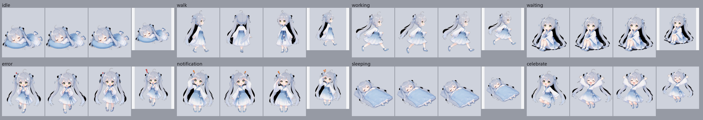
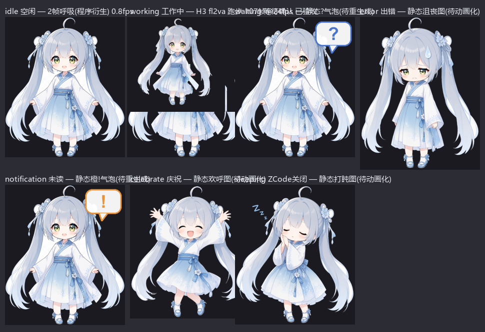

# ZCode 桌宠 —— 会感知 AI 助手状态的桌面宠物

<p align="center">
  <em>悬浮于 Windows 桌面的 Q 版桌宠（洛天依·汉服形象），实时感知 ZCode（智谱 AI 编程助手）的运行状态并切换动画：空闲、工作中、等待确认、出错、有通知、休眠。</em>
</p>

<p align="center">
  
</p>

## 项目简介

ZCode 桌宠是一个透明置顶的 Electron 窗口，承载一个 Q 版洛天依（汉服）形象，**实时映射我的 AI 编程助手的运行状态**：会话跑起来她在奔跑，任务出错她会着急，ZCode 退出她就睡觉。状态源直接读取 ZCode 本地会话数据库（运行中会话数 / 未读 / 错误任务），所以这个"桌宠"其实是一个小而完整的**系统集成项目**：SQLite 内省、状态机、帧动画引擎、多 DPI 窗口工程，以及一整套脚本化的素材管线。

> 🇬🇧 English version: [README.md](README.md)

## 核心亮点

- 🎭 **6 个实时状态 + 踱步** —— 工作中（全力奔跑）/ 空闲 / 等待确认 / 出错 / 有未读会话 / 休眠，由 ZCode 会话库（tasks、session、turn_usage 表）实时驱动
- 🎬 **Pose-first 素材管线** —— 8 关键帧 × 8 视频批量生成；**MiniMax-H3 fl2va** 首尾帧插值客户端；服务器侧管线（EditPlus 姿态 + Animate2 跑步帧）；walk v4 = 222 帧镜像 @ 20 fps（11.1 s/周期）
- ✂️ **自动抠图与状态衍生** —— RVM（MobilenetV3）背景移除；黑底改全局亮度键并修复三大病灶（封闭黑洞 / premultiply 黑边 / 接缝白影守卫）；manifest 驱动的状态素材组织
- 🪟 **扎实的窗口工程** —— 透明置顶、按状态自适应窗口尺寸（宽横构图不再溢出）、混合 DPI 双屏适配、位置记忆 + `ensureOnScreen` 屏外拉回
- 🐕 **看门狗生命周期** —— watchdog 常驻保活，随 ZCode 启停

## 技术栈

<div>
  
  
  
  
  
  
</div>

## 系统架构

```
ZCode 会话数据库（sqlite：tasks-index / cli db）
        │  tools/zcode_state.py + pet/zcode_state.js（查询）
        ▼
  状态机（6 状态 + 踱步）────► 帧动画引擎
        │                            │
        ▼                            ▼
  Electron 透明置顶窗口 + 托盘 + 拖动
  （位置记忆 · ensureOnScreen · 按状态定尺寸 · 混合 DPI）

素材管线（离线）：
  原始立绘 → RVM 抠图 → make_states 状态衍生 → manifest.json
  pose-first：8 关键帧 → H3 fl2va 首尾帧视频 → 抽帧
```

## 演示图

| 全状态总览 | 动作总览 |
|---|---|
|  |  |

更多质检渲染图见 [docs/img/](docs/img/)。

## 仓库结构

```
pet/            # Electron 应用：main.js、preload、renderer、zcode_state.js
assets/sprites/ # 状态素材 + manifest.json（角色版权见 NOTICE.md）
tools/          # 素材管线：bg_remove.py、make_states.py、gen/*（H3 客户端）、
                # monitor_console.py、zcode_state.py、看门狗
docs/           # 01 ZCode 源码分析 · 02 架构调研 · 03 素材准备
                # 04 动画规划 · 05 多智能体架构
启动桌宠.bat     # 启动器
```

## 快速上手

```bash
cd pet
npm install        # Electron 39
npm start          # 或双击 启动桌宠.bat
```

需要本机装有 ZCode 才有实时状态；没有时桌宠只会待机/休眠。

## 文档

- ZCode 会话监控源码分析：[docs/01-zcode-source-analysis.md](docs/01-zcode-source-analysis.md)
- 桌宠架构调研：[docs/02-pet-architecture-research.md](docs/02-pet-architecture-research.md)
- 素材准备：[docs/03-asset-prep.md](docs/03-asset-prep.md)
- 动画规划：[docs/04-animation-plan.md](docs/04-animation-plan.md)

## 许可证

- 代码（`pet/`、`tools/`、`docs/`）：**MIT** © 2026 TZH-user，见 [LICENSE](LICENSE)
- 角色素材（`assets/sprites/`）：洛天依二次创作同人素材，**仅限非商业、不随 MIT 授权**，见 [NOTICE.md](NOTICE.md)
